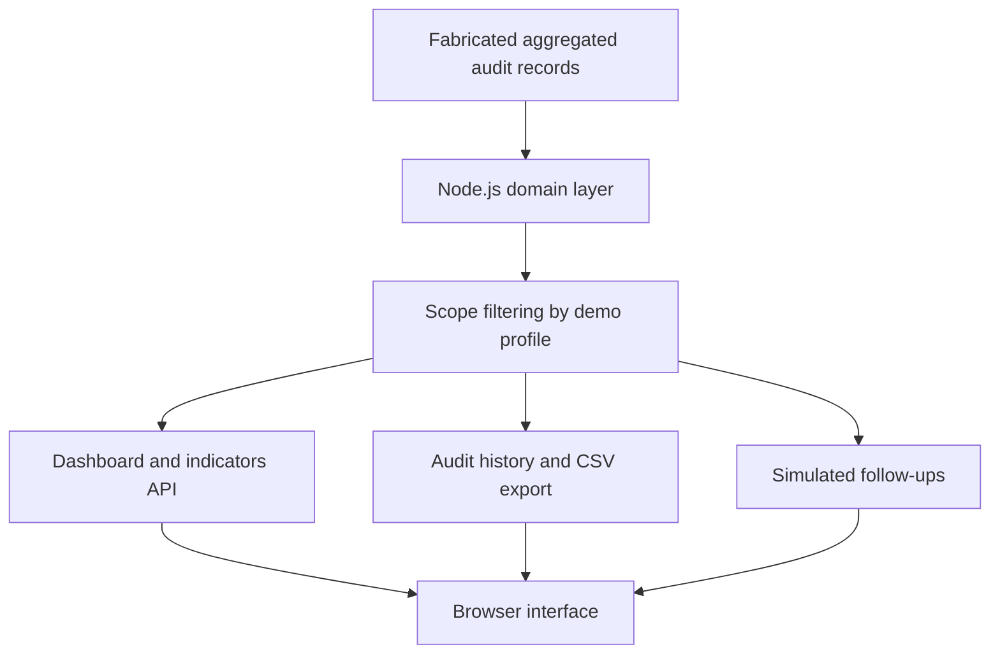

# Architecture Notes

This public project is a **new, independent demonstration** of a client-facing occupational audit portal. It was not exported from an operational client or company account.

## Data flow

1. `src/data.js` generates deterministic fictional audit records. There are no names, health records, credentials, external IDs, or operational references.
2. `src/domain.js` filters events by time interval and company, computes totals, rates, issue breakdowns, monthly trend and performance rankings.
3. `src/server.js` hosts a local JSON API. Each selected demo profile receives a distinct in-memory session and its own synthetic records. The tenant scope is resolved **on the server**, not from a trusted client-supplied tenant ID.
4. `public/` displays charts, tables, the audit history, records, CSV export and simulated follow-ups.
5. Updates to follow-ups are written **only to the current session's memory**, not to a spreadsheet or external service.

## Modules

| Component | Runtime | Purpose |
| --- | --- | --- |
| Web interface | HTML/CSS/JavaScript | Navigation, charts and responsive layout |
| Demo API | Node.js 20+ | Local endpoints, scoping and session demo |
| Aggregation | JavaScript | Filters and KPI calculations |
| Synthetic source | JavaScript | Reproducible fictional audit records |
| Standalone alternative | Google Apps Script | Simplified independent example in `apps-script-example/` |

The source workflow that inspired this portfolio concept used Google Apps Script, Google Sheets and an embedded web interface. **This project does not reproduce or connect to that operational setup.** The Node.js implementation is the primary executable demo, and the Apps Script folder is a separate, simplified mock example.

## Functional boundaries

- No production login, employee or patient data
- No live events or eSocial connection
- No Google Sheets or Google Sites account required
- No shared multiuser database
- Demo access is not a substitute for corporate authentication
- In-memory data and treatment status reset when the server restarts or the session ends
